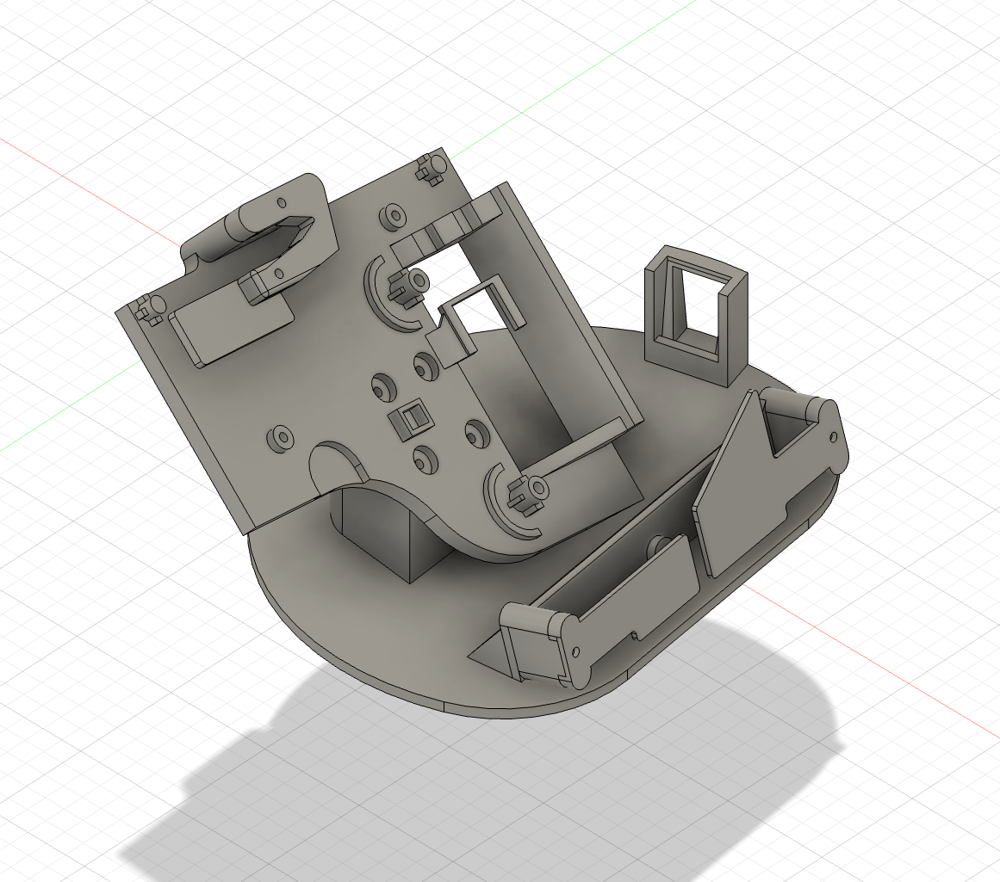
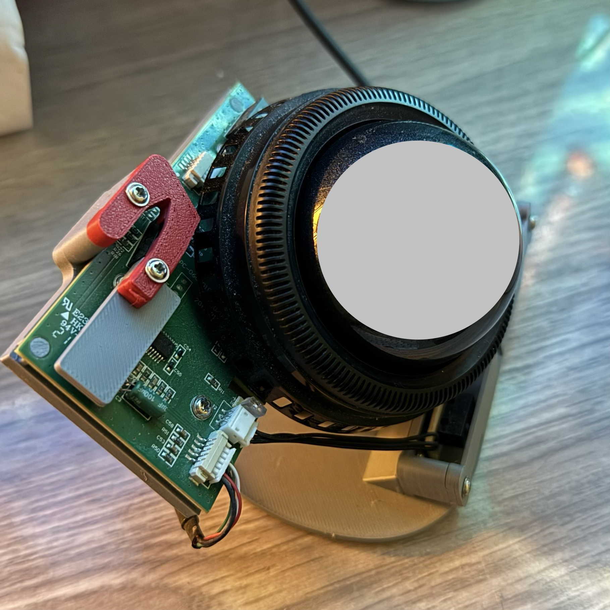
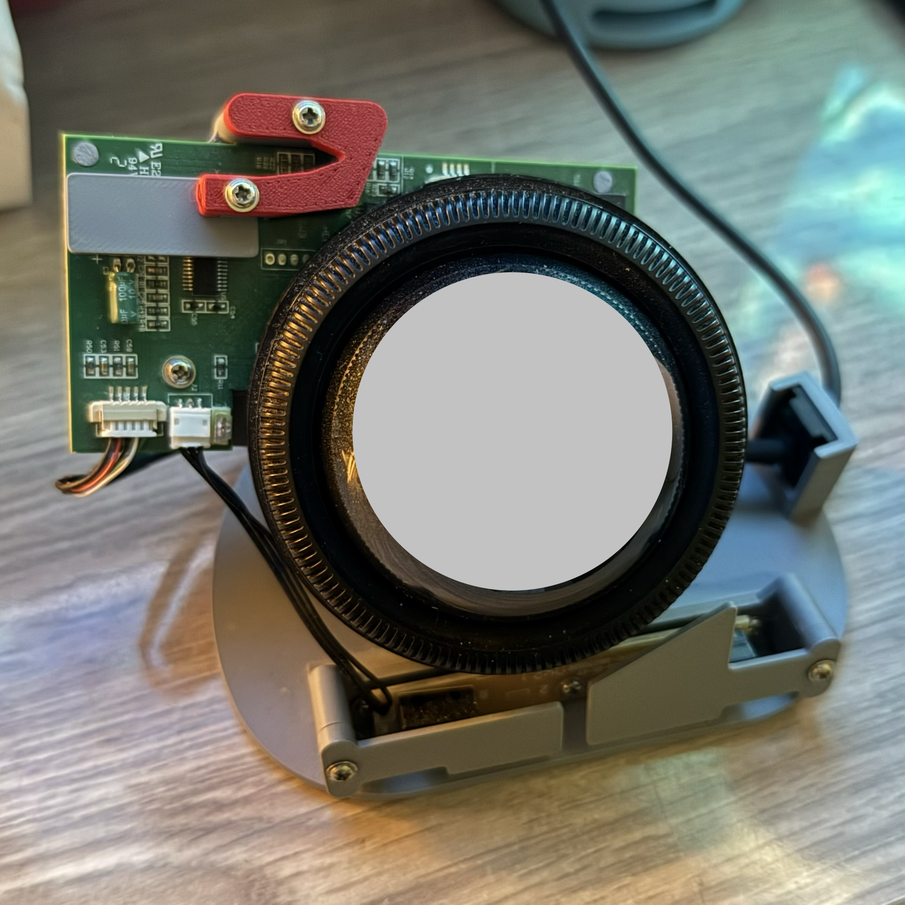
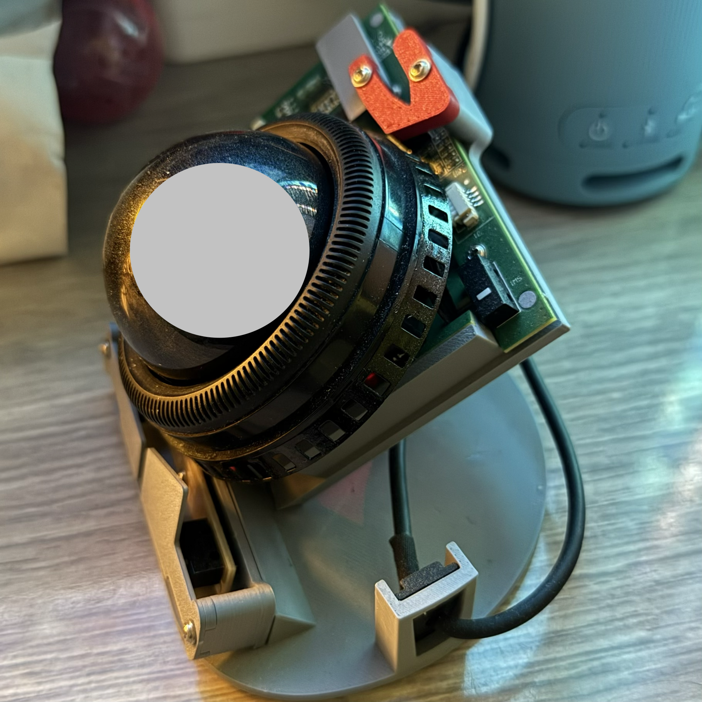
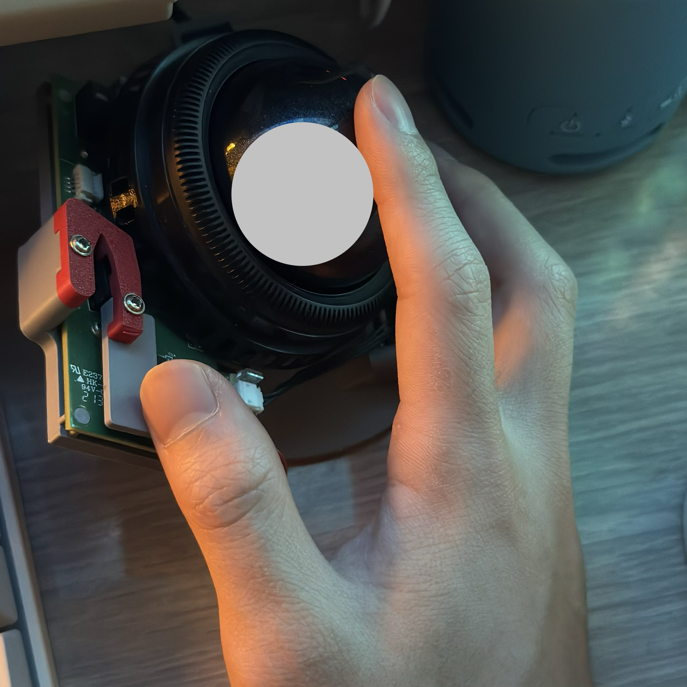

 
 

A vertical trackball that reuses parts from Kensington Expert Mouse.

Only parts in the original product (including screws) are used. If you have the product, you're ready.

This only works for wired version. Wireless version has a slightly different PCB and requires a battery holder, which is not included in this design.

This doesn't use the top left button. Therefore there are only 3 usable buttons on this trackball. I don't use the top left one anyway.

Consider the dust in the photo as proof of actual use... I printed it with PLA and have been using it as my daily gear for 7 months.
